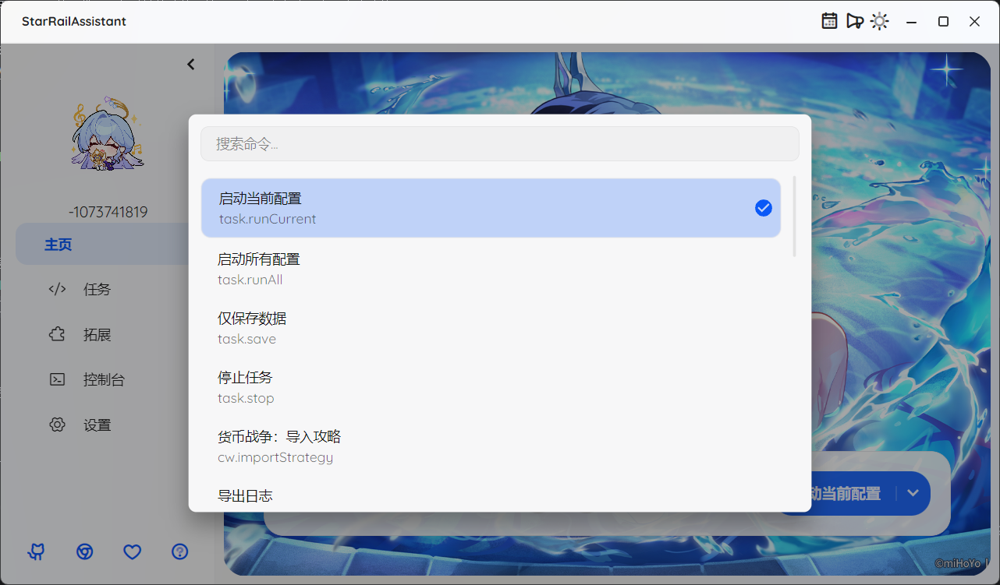

This page introduces SRA's more advanced features so you can get the most out of it.

## Multi-Account Management

SRA lets you configure a separate automation profile for each account.
The following instructions use the operation panel from version `2.0.0` and later as an example.


### Create a New Profile

Click the + button on the left of the operation panel to open the profile name input box.

Enter a profile name and click the confirm button on the right to add a new profile to the configuration list.
If the profile name is empty, the input box closes and nothing happens.

#### Example

Each `configuration profile` corresponds to the automation setup for one account. Suppose you want to configure accounts A, B, and C.

- For account A
  Use the default profile Default and finish the task configuration on the `Task` tab. When using multi-account management:
  These tasks **must be configured**:
  - Click `Start Game` - select `Game Path`
  - Click `Start Game` - check `Auto login` (fill in the account and password at the same time)
  - Click `In the End` - check `Log out of the current account`
    These tasks **must not be configured**:
  - Exit the game
  - Exit SRA
  - Shut down
  - Sleep
    After finishing the `task configuration`, the following actions save the current `configuration profile`:
  - Switching profiles
  - Running tasks
  - Closing the window
- For account B
  Click the + button on the left of the operation panel, enter a profile name such as 'planB', and click the confirm button.
  Open the configuration profile selector on the right to see the new planB profile. Select it, then configure planB the same way as the Default profile.
- For account C
  Same as above.

Now we have three profiles: Default, planB, and planC. All that's left is to switch the button on the operation panel to `Launch All` mode and click it to start multi-account management.
Profiles run from top to bottom: Default, then planB, then planC.
For multi-account management to work as expected, we recommend checking `Always log in again` for each profile and filling in the account and password, so SRA logs in to the right account automatically when launching the game.
You can now return to the SRA operation panel and click `Launch All` to start your multi-account automation.

## Custom Currency Wars Strategies

The Currency Wars task in SRA uses predefined strategies. See `tasks/currency_wars/strategies/template.json`.

### Writing a Strategy

```json
{
  "title": "攻略模版", // 攻略名称
  "description": "这是一个攻略模版，请根据实际情况进行修改。", // 攻略描述
  "author": "作者", // 攻略作者
  "uploader": "可选，默认与作者相同", // 攻略上传者，可选，默认为作者
  "share_code": "攻略分享码，可以为空或缺省", // 攻略分享码，如果你制作的攻略在官服攻略大全中有对应的分享码，将其填写在这里，以便指定推荐装备。
  "min_coins": 40, // 最小金币保留数量，当金币数量少于这个数量时，SRA会跳过购买角色和提升等级
  "min_level": 6, // 最小等级要求，当等级低于这个值时，SRA会优先提升等级
  "mid_level": 9, // 中等等级要求，当等级低于这个值时，SRA会在购买角色中穿插提升等级
  "on_field": {
    // 前台角色字典
    "姬子·启行": 3, // 格式为 角色名: 星级
    "瓦尔特": 1, // 例如：这个键值对告诉SRA应该购买到1星瓦尔特
    "开拓者": 2, // 例如：这个键值对告诉SRA应该购买到2星开拓者
    "花火": 2, // 也可以把后台角色强制放到前台
    "星期日": 1,
    "丹恒·饮月": 2
    // 角色在字典中出现的顺序即为角色在场上的位置
    // 例如，如果想让"姬子·启行"在前台1号位，只需把她放到字典顶部
    // 如果攻略需要前期过渡阵容，越前期的角色越在底部。
  },
  "off_field": {
    // 后台角色字典
    "三月七": 2,
    "刻律德菈": 3,
    "符玄": 2,
    "千冶·刃": 2, // 角色顺序同时也是站位，例如当场上只有七个位置，但我们有八名角色时，千冶·刃会优先上场
    "缇宝": 2
  },
  "special_events": {
    // 特殊事件处理
    "领航员": "护盾" // 例如：当触发领航员羁绊时，SRA会选择”护盾“选项
  }
}
```

You can follow the fields in this file to customize your own strategy. See [Creating and Adding Custom Currency Wars Strategies](/en/tutorials/make_strategy) for details.

### Downloading Strategies

If you don't want to write strategies yourself, you can download strategies made for SRA from the [SRA strategy site](https://starrailassistant.top/strategy/).

### Adding a Strategy

Open the `tasks/currency_wars/strategies/` folder and put the strategy file you wrote or downloaded (for example `my_strategy.json`) into it.
In the Currency Wars task configuration in SRA, click the refresh button to the right of the `Strategy` drop-down menu, and your strategy will appear in the list. Select it to use your custom strategy.

## Extensions

Click `Extension` in the sidebar to open the extension tab.


### Auto Dialogue

When enabled, dialogue plays automatically and dialogue options are selected automatically when a story sequence starts.
Skip dialogue: requires Auto Dialogue to be enabled first; once enabled, skippable dialogue is skipped automatically when a story sequence starts.
Extensions take effect immediately after being enabled and keep running until you uncheck them.

## Settings

Click `Setting` in the sidebar to open the tab where you can change SRA's settings.

### General Task Settings


- Game Path: sets the game's installation path. By default, SRA detects the game paths of all installed clients on this device and lets you choose one. Turn off auto-detection to add a game path manually.
- Use Star Rail Cloud Game (experimental): when enabled, SRA automates the game through Star Rail Cloud. Only Microsoft Edge is currently supported, so make sure it is installed on your device.
- Image recognition confidence threshold: controls how strict the app is when recognizing in-game elements. The default is 0.90 (90%) and can be adjusted between 0 and 1
  in steps of 0.01. Higher values make recognition stricter (fewer false positives); lower values widen the range (false positives may occur).
- Stop hotkey: sets a global hotkey that immediately stops the current task while it is running. The default is `F9`. Click the input box and press the hotkey you want to change it. Click elsewhere to cancel the change.

### Game Launch Arguments


- Enable window settings: when enabled, SRA applies the settings below when launching the game.
- Window Size: sets the game window resolution. The default is `1920x1080` and cannot be changed; only this resolution is supported.
- Display Mode: sets the game's display mode. The default is `Windowed`, and it can be switched to `Fullscreen`.
- Borderless Window: when enabled, the game window has no border or title bar, for a more immersive experience.
- Advanced Parameters: extra game launch arguments can be added in this input box.
- Launch Game Using CMD: when enabled, SRA launches the game through the command line (CMD), which can be more effective for some games that need specific environment variables or arguments.
- In addition, enabling launch arguments also turns on the following:
  - Follow auto-battle settings and enable auto battle

### In-Game Hotkey Settings


If you change hotkeys in the game, update the hotkeys here accordingly so SRA can perform in-game actions correctly.

### Display Settings


- Background Image: sets the background image of the home page. Paste the local path of an image into the input box to change it; common image formats such as PNG and JPG are supported. For example,
  `"C:\path\to\your\image.png"`. If the input box is empty, the default background image is used.
- Background Image Opacity: adjusts the opacity of the home page background image. The default is 0.9 (90% opaque).
  Drag the slider to fine-tune between 0 and 1; lower values are more transparent, higher values are clearer (0 is fully transparent, 1 is fully opaque).
- Control Panel Opacity: adjusts the opacity of the control panel background. The default is 0.9 (90% opaque).
  Drag the slider to fine-tune between 0 and 1; lower values are more transparent, higher values are clearer (0 is fully transparent, 1 is fully opaque).
- Language: selects the display language of the app interface. The default is "简体中文" (Simplified Chinese). It can be switched to "English"; the app must be restarted for the change to take effect.

### General Settings


- Notification management
  - Allow Notification: the master switch. Notifications of all kinds can only be received after it is enabled (enabled by default); when it is off, all notifications are blocked.
  - System Notification: when enabled, the app sends reminders through system pop-ups (such as update notices and task completion prompts; enabled by default).
  - Email Notification: when enabled, the app sends important information by email (such as error alerts; disabled by default). The receiving mailbox must be configured in advance.
    - SMTP Settings: see the [Notification Configuration → Email Notification](#email-notification) section below.
  - External notification channels: supports channels such as Webhook, Telegram, ServerChan, OneBot, Bark, Feishu, WeCom, DingTalk, Discord, and xxtui.
    See the [Notification Configuration](#notification-configuration) section below.
- Create desktop shortcut: if you previously chose "Don't ask again" in the dialog that offers to create a desktop shortcut, you can create the shortcut again here.

### Update Settings


- Check for updates: click the button to check for a new version manually.
- Auto Update: when enabled, the app detects new versions automatically and downloads and extracts the update package.
- Mirror Chyan CDK: enter the authorization code (CDK) for the Mirror Chyan accelerated download service to unlock accelerated update downloads. Input is masked with "\*", and the CDK
  status (such as "Activated" or "Expired") is shown below.
- Update Channel: selects the download source for update packages. The default is "GitHub" (official source, no authorization required).
  It can be switched to "Mirror Chyan" (accelerated source, requires a valid CDK) or AUTO-MAS (mirror source provided by AUTO-MAS, no authorization required).
- Application Channel: selects the app's version type. The default is "stable" (stable release with fewer bugs, suitable for daily use); it can be switched to "beta" (test release with the newest features and possibly a few bugs).

### Advanced Settings


- Folder shortcut buttons: click the corresponding button to quickly open the related folder of the app:
  - Backend log folder: the folder that stores the app's frontend runtime logs.
  - Frontend log folder: the folder that stores the app's backend runtime logs.
  - Configuration folder: the folder that stores user configuration files (such as task configurations and multi-account configurations).
  - Application folder: the folder that stores temporary data and cache generated while the app runs.
- Resource integrity check: not yet implemented and currently disabled. The "Resource file check" feature cannot be triggered manually for now and may become available in a later version (it detects whether core files are corrupted or tampered with).

### Developer Options


You can enable Developer Options by clicking the version number quickly several times.

- Enable Developer Options: when enabled, developer-oriented features and settings are shown; when disabled, those entries are hidden.
- Save OCR Image: when enabled, the app saves the images captured during OCR while running tasks, for developers to analyze and debug.
- Run the backend from Python source: when enabled, SRA uses the specified Python environment to run the backend service instead of the bundled executable. This makes it easier for developers to debug and modify backend code.
- Python interpreter: after enabling "Run the backend from Python source", specify the path to the Python interpreter here. Click the input box and enter the path to the Python executable.
- Main program path: after enabling "Run the backend from Python source", specify the path to the SRA main program here. Click the input box and enter the path to the SRA main program (for example,
  `main.py`).

### About


- Version: shows the current app version. Click the version number quickly several times to enable Developer Options.

## Console


The Console tab shows the app's runtime logs, helping you understand its running state and debug information.

### Log Filters

Go to the Console tab to see the log filters.
There are five log level buttons:

- TRACE: trace level, shows the most detailed log information, usually for debugging
- DEBUG: debug level, shows debug information to help developers diagnose problems
- INFO: info level, shows general information, usually recording normal program operation
- WARNING: warning level, shows warnings about potential problems
- ERROR: error level, shows error messages, usually recording errors during program execution

Click a button to toggle whether logs of that level are shown. A highlighted button means logs at that level are displayed; a dimmed button means they are hidden.
If you want to use this information to report a problem to the developers, you must enable the TRACE and DEBUG log levels.

### Interactive Input Box

At the bottom of the Console tab there is an interactive input box with the placeholder "Please enter text", which accepts user input.
Type text here and press Enter to submit it.
After submission, the text is sent to SRA's standard input stream for the program to read and process.
See [Basic Usage of SRA-cli](/en/cli/simple-usage) for details.

### Restart Button

To the right of the `Console` text is a restart button (with a rotating arrow icon).
Click it to restart the backend service.

### Stop Button

To the right of the `Console` text is a stop button (with a stop icon).
Click it to stop the backend service.
This is useful when the backend service is running and cannot be stopped normally after entering the `run` or `single` command.

## SRA Launch Arguments

SRA supports command-line arguments that control how the app starts. Here are some common ones:

- `--use-python`: enables running the backend from Python source, equivalent to turning on that option in Developer Options.

SRA also accepts arbitrary arguments to pass to the backend program. These arguments are forwarded directly to SRA-cli, letting you specify backend behavior at startup.
See [SRA-cli Command-Line Arguments](/en/cli/argument-and-startup) for details.

## Command Palette

Press `Ctrl+Shift+P` on any page of the app to open the command palette; press it again or press `Esc` to close it. The command palette gathers common actions into one searchable list, so you no longer have to look for buttons page by page.



### Basic Operations

- The input box is focused automatically; type a keyword to filter
- You can search by command name or command ID, for example "Toggle" or `view.toggleTheme`
- `↑` / `↓` move the selection, `Enter` runs it; you can also click an entry with the mouse
- Clicking the overlay outside the panel closes it

## Notification Configuration

SRA supports multiple notification channels that push messages to you when tasks complete, fail, or error out. All channels are off by default; enable and configure the ones you need.

:::tip
All notification channels are controlled by the "Allow Notification" master switch. Make sure the master switch is enabled.
:::

### Notification Payload Format

When SRA sends notifications to each channel, the payload has the following format (shown for Webhook; other channels format it as plain text):

```json
{
  "title": "任务完成提醒",
  "event": "任务完成提醒",
  "result": "success",
  "timestamp": "2025-01-01 12:34:56",
  "message": "您的SRA任务运行完成。"
}
```

| Field       | Description                                                   |
| ----------- | ------------------------------------------------------------- |
| `title`     | Notification title                                            |
| `event`     | Name of the event that triggered the notification, same as `title` |
| `result`    | Result: `success` for success, `fail` for failure              |
| `timestamp` | Time the notification was triggered, in `YYYY-MM-DD HH:MM:SS` |
| `message`   | Notification body                                             |

### Notification Triggers

| Trigger                                     | result    |
| ------------------------------------------- | --------- |
| All tasks completed normally                | `success` |
| A single task failed (returned False)       | `fail`    |
| A single task crashed with an exception     | `fail`    |

### Email Notification

Email notifications were introduced in version `0.8.1`.

In Settings, check `Email Notification`, then configure the SMTP service below and click verify.

SMTP is a reliable and effective email transport protocol; SRA pushes email notifications over SMTP-SSL.

##### SMTP Server Address

Choose the correct SMTP server address for the email service provider of the sending mailbox.

| Email service provider | SMTP server address   |
| ---------------------- | --------------------- |
| QQ Mail                | smtp.qq.com           |
| 163 Mail               | smtp.163.com          |
| Gmail                  | smtp.gmail.com        |
| Outlook/Hotmail        | smtp-mail.outlook.com |
| Yahoo Mail             | smtp.mail.yahoo.com   |

The table above lists some email providers and their SMTP server addresses. If your provider is not listed, look it up yourself or ask the provider.

#### Authorization Code

An **authorization code** is a special password that replaces your mailbox password when signing in from a third-party client. You need to enter the authorization code of the sending mailbox.

The steps to obtain an authorization code for some providers are listed below:

- [QQ Mail](https://service.mail.qq.com/detail/0/75)
  - Sign in to your mailbox, then open the [QQ Mail Account and Security Center](https://wx.mail.qq.com/account)
  - Under `Account and Security` -> `Security Settings` -> `SMTP/IMAP Service`, enable the service and get the authorization code

- [163 Mail](https://help.mail.163.com/faqDetail.do?code=d7a5dc8471cd0c0e8b4b8f4f8e49998b374173cfe9171305fa1ce630d7f67ac2a5feb28b66796d3b)
  - Sign in to your mailbox, then go to `Settings` -> `POP3/SMTP/IMAP`, find `IMAP/SMTP Service` and click to enable it
  - Follow the prompts in the dialog; the dialog generates an authorization password, which is the authorization code.

- **Gmail**
  - Sign in to your mailbox, then open [Security](https://myaccount.google.com/security?) -> `How you sign in to Google` -> `2-Step Verification`
    and follow the instructions to turn on 2-Step Verification.
  - Open [App passwords](https://myaccount.google.com/apppasswords) and follow the prompts to get an app password; that password is the authorization code.

:::tip
Starting January 2025, the "Enable IMAP" and "Disable IMAP" options are no longer available. IMAP
access in Gmail is always on, and your current connections to other email clients are unaffected. You don't need to take any action.
:::

- **Outlook/Hotmail**
  - Sign in to your `Microsoft account`, then open [Additional security options](https://go.microsoft.com/fwlink/?linkid=2274139) -> `Two-step verification`
    and follow the instructions to turn it on.
  - After turning on two-step verification, scroll down to `App passwords` and click `Create a new app password`

- [Yahoo Mail](https://help.yahoo.com/kb/generate-third-party-passwords-sln15241.html)
  - Sign in to [Yahoo Account Security](https://login.yahoo.com/account/security?.lang=en-US&.intl=us&.src=yhelp)
  - Click `Generate app password` or `Generate and manage app passwords` -> `Get Started` -> enter your app name in the text field
  - Click `Generate password`; this password is the authorization code.

:::warning
For your information security, do not share the authorization code with others, and change it regularly.

Some mailboxes show the authorization code only once, so save it promptly; some providers' authorization codes expire, so change them before they expire.

SRA encrypts locally stored authorization codes with `Windows DPAPI`. This encryption uses the current user's login credentials as part of the key, which means the data can only be decrypted by the same user on the same computer. If you need to migrate configuration files across devices, enter the authorization code again.

The **SMTP** email push service allows the sending mailbox and the receiving mailbox to be the same. If you don't have an extra email address, you can fill in the same address for both.
:::

### Webhook

In Settings, check `Enable Webhook` and fill in the Webhook URL.

- **Webhook URL**: the HTTP endpoint that receives notifications. SRA sends a POST request with `Content-Type: application/json`, and the request body is the notification payload format shown above.

:::tip
Webhook is suitable for integrating with self-hosted services or third-party platforms and is the most flexible channel.
:::

### Telegram

In Settings, check `Enable Telegram notification` and fill in the following:

- **Bot Token**: the token of your Telegram bot, obtained after creating a bot through [@BotFather](https://t.me/BotFather).
- **Chat ID**: the ID of the chat that receives messages, obtainable through [@userinfobot](https://t.me/userinfobot).
- **Proxy**: if you cannot access the Telegram API directly, enable the proxy and fill in the proxy address (such as `http://127.0.0.1:7890`).
- **Custom API address**: if you use a self-hosted Telegram Bot API server, fill it in here; leave empty to use the official API.
- **Send screenshot**: when enabled, notifications include a screenshot of the current game screen.

### ServerChan

[ServerChan](https://sct.ftqq.com) is a service that pushes messages to WeChat.

In Settings, check `Enable ServerChan notification` and fill in:

- **SendKey**: obtained after signing in to the ServerChan website; both the SCT format (`SCT...`) and the sctp format (`sctp...`) are supported.

### OneBot

[OneBot](https://onebot.dev) is a unified chatbot interface standard, commonly used for QQ bots (such as [NapCat](https://napneko.github.io/), LLOneBot,
and others).

In Settings, check `Enable OneBot notification` and fill in the following:

- **Endpoint**: the OneBot HTTP API address (such as `http://127.0.0.1:3000`).
- **User ID**: the QQ number that receives private messages (fill in at least one of user ID and group number).
- **Group number**: the group number that receives group messages (fill in at least one of user ID and group number).
- **Access Token**: the access token for the HTTP API; leave empty for no authentication.
- **Send screenshot**: when enabled, notifications include a screenshot of the current game screen.

#### Using NapCat as an Example

[NapCat](https://napneko.github.io/) is one of the actively maintained and easy-to-install OneBot v11 implementations.

1. Follow the [official NapCat documentation](https://napneko.github.io/) to install it and sign in to a QQ account
2. In the NapCat web console → **Network Config** → add an **HTTP Server**
3. Note the port number (default `3000`); the Access Token is optional
4. In SRA, fill in:

- Endpoint: `http://127.0.0.1:3000`
- User ID: your own QQ number (the bot account sends you a private message)
- Access Token: the same as the one set in NapCat; leave empty if none is set

:::tip
We recommend deploying the bot locally: just set the Endpoint to `http://127.0.0.1:<port>`, no public network is needed. The bot account and the receiving account can be the same QQ
number (sending messages to yourself).
:::

### Bark

[Bark](https://bark.day.app) is an iOS push notification app.

In Settings, check `Enable Bark notification` and fill in the following:

- **Device Key**: copied from the Bark app home page; separate multiple devices with English commas.
- **Bark API endpoint**: the Bark server address, defaults to `https://api.day.app`; change it when using a self-hosted server.
- **Push level**: `active` (default), `timeSensitive` (time-sensitive, shown even in Focus mode), or `passive` (silent).
- **Notification sound**: a custom notification sound such as `minuet`; leave empty for the default.
- **Notification icon**: the URL of a custom notification icon (requires iOS 15 or later).
- **Notification group**: the group name of the notification in the Bark app, defaults to `StarRailAssistant`.
- **Encryption key**: fill in when end-to-end encryption is enabled; leave empty for no encryption.

### Feishu

In Settings, check `Enable Feishu notification`. Two methods are supported:

**Option 1: Group bot Webhook (recommended)**

- **Feishu notification URL**: obtained after adding a custom bot in the Feishu group settings → Group Bots.

**Option 2: App API (can send to specific users)**

- **Feishu AppId**: obtained after creating a custom app on the [Feishu Open Platform](https://open.feishu.cn/app).
- **Feishu AppSecret**: the app secret that goes with the AppId.
- **Receiver ID**: the ID of the user or chat that receives messages.
- **ID type**: the type of the receiver ID; `open_id` (default), `user_id`, or `chat_id`.

:::tip
If both methods are filled in, the App API method takes priority.
:::

### WeCom

In Settings, check `Enable WeCom notification` and fill in:

- **Webhook URL**: obtained after adding a group bot in the WeCom group settings.
- **Send screenshot**: when enabled, notifications include a screenshot of the current game screen.

### DingTalk

In Settings, check `Enable DingTalk notification` and fill in:

- **Webhook URL**: obtained after adding a custom bot in the DingTalk group settings → Smart Group Assistant.
- **Signing secret**: if the bot has signature verification enabled, fill in the secret starting with `SEC`; leave empty for no signature.

:::warning
When creating a DingTalk bot, under security settings **select only "Sign"**. Do not enable other options (such as custom keywords or IP ranges) at the same time, or notifications will fail to send.
:::

### Discord

In Settings, check `Enable Discord notification` and fill in:

- **Webhook URL**: create and copy the URL in the Discord channel settings → Integrations → Webhooks.
- **Send screenshot**: when enabled, notifications include a screenshot of the current game screen.

### xxtui

[xxtui](https://xxtui.com) is an aggregated push platform that forwards messages to WeChat Official Accounts, WeCom, DingTalk, Bark, and other channels.

In Settings, check `Enable xxtui notification` and fill in:

- **API key**: obtained from the console after signing in to xxtui.com.
- **Notification source**: a message source identifier, optional, such as `StarRailAssistant`.
- **Notification channel**: the target channel, optional, such as `WX_MP` (WeChat Official Account); leave empty to use the default channel.

---

:::tip Screenshot Notes
Channels that support sending screenshots (Telegram, OneBot, WeCom, Discord) each have their own "Send screenshot" switch on the settings page.

- **Task notifications**: when a task completes or fails and the switch is on, a screenshot of the current game screen is sent along with the notification.
- **Test notification**: when you click the Check button to test and the switch is on, the SRA icon is sent instead of a screenshot, so that unrelated content is not captured.
:::
