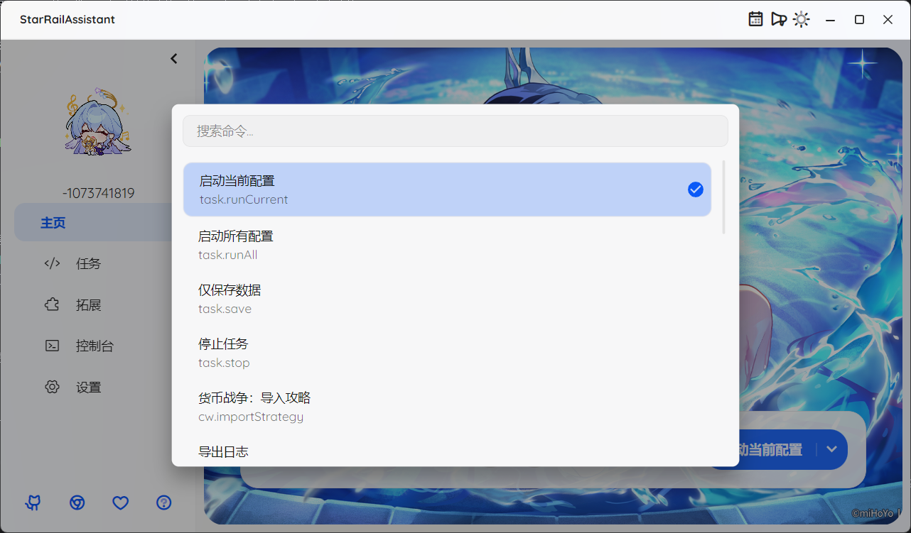

帮助您了解SRA的更多高级功能，帮助您更好地使用SRA。

## 多账号托管

SRA 支持为多个账号配置不同的托管方案。
下面的内容以 `2.0.0` 版本之后的操作面板为例进行说明。


### 新建方案

点击操作面板左侧的 + 按钮，即可出现方案名称输入框。

输入方案名称后，点击右侧确认按钮，即可向配置方案列表中添加一个新方案。
如果方案名称为空，则会关闭输入框而不执行任何操作。

#### 示例

每个 `配置方案` 对应着一个账号的托管方案，假设将要配置A、B、C三个账号托管

- 对于账号 A
  使用默认方案Default，到标签页 `任务` 中完成任务配置，在使用多账号托管时:
  这些任务**必须配置**：
  - 点击 `启动游戏` -选择 `游戏路径`
  - 点击 `启动游戏` -勾选 `自动登录` (同时填充账号与密码)
  - 点击 `结束后` -勾选 `退出当前账号`
    这些任务**不能配置**：
  - 退出游戏
  - 退出SRA
  - 关机
  - 休眠
    完成 `任务配置` 后，这些行为会触发当前 `配置方案` 的保存：
  - 切换方案
  - 执行任务
  - 关闭窗口
- 对于账号B
  点击操作面板左侧的 + 按钮，输入一个方案名称，例如' planB '，后点击确认按钮
  点击右侧的配置方案选框就可以看到我们新建的planB，选中它，接下来像配置方案default那样配置planB即可。
- 对于账号C
  同理。

现在我们有了三份方案，分别为default、planB、planC。接下来只需要将操作面板中的按钮切换到 `启动全部配置` 模式，然后点击即可开始多账号托管。
方案的执行顺序为从上到下，依次执行default、planB、planC。
为了使多账号托管按预期运行，建议为每个方案勾选 `总是重新登录` 选项，并填写账号密码，这样SRA会在启动游戏时自动登录到对应账号。
现在，您可以回到SRA的操作面板，点击 `启动全部配置` 即可开始您的多账号托管之旅。

## 货币战争自定义攻略

SRA 的货币战争任务使用预定义的攻略，参阅 `tasks/currency_wars/strategies/template.json`

### 编写攻略

```json
{
  "title": "攻略模版", // 攻略名称
  "description": "这是一个攻略模版，请根据实际情况进行修改。", // 攻略描述
  "author": "作者", // 攻略作者
  "uploader": "可选，默认与作者相同", // 攻略上传者，可选，默认为作者
  "share_code": "攻略分享码，可以为空或缺省", // 攻略分享码，如果你制作的攻略在官服攻略大全中有对应的分享码，将其填写在这里，以便指定推荐装备。
  "min_coins": 40, // 最小金币保留数量，当金币数量少于这个数量时，SRA会跳过购买角色和提升等级
  "min_level": 6, // 最小等级要求，当等级低于这个值时，SRA会优先提升等级
  "mid_level": 9, // 中等等级要求，当等级低于这个值时，SRA会在购买角色中穿插提升等级
  "on_field": {
    // 前台角色字典
    "姬子·启行": 3, // 格式为 角色名: 星级
    "瓦尔特": 1, // 例如：这个键值对告诉SRA应该购买到1星瓦尔特
    "开拓者": 2, // 例如：这个键值对告诉SRA应该购买到2星开拓者
    "花火": 2, // 也可以把后台角色强制放到前台
    "星期日": 1,
    "丹恒·饮月": 2
    // 角色在字典中出现的顺序即为角色在场上的位置
    // 例如，如果想让"姬子·启行"在前台1号位，只需把她放到字典顶部
    // 如果攻略需要前期过渡阵容，越前期的角色越在底部。
  },
  "off_field": {
    // 后台角色字典
    "三月七": 2,
    "刻律德菈": 3,
    "符玄": 2,
    "千冶·刃": 2, // 角色顺序同时也是站位，例如当场上只有七个位置，但我们有八名角色时，千冶·刃会优先上场
    "缇宝": 2
  },
  "special_events": {
    // 特殊事件处理
    "领航员": "护盾" // 例如：当触发领航员羁绊时，SRA会选择”护盾“选项
  }
}
```

您可以仿照这个文件中的一些字段，以完成对攻略的自定义。详见 [制作和添加自定义货币战争攻略](/tutorials/make_strategy)

### 下载攻略

如果你不会自己编写攻略，你也可以在[SRA攻略站](https://starrailassistant.top/strategy/)下载适用于 SRA 的攻略。

### 添加攻略

打开 `tasks/currency_wars/strategies/` 文件夹，将编写好的或者下载的攻略文件（例如 `my_strategy.json`）放入该文件夹中。
在 SRA 的货币战争任务配置界面中，点击 `攻略` 下拉菜单右侧刷新按钮后，就可以看到你添加的攻略了，选择它即可使用自定义攻略。

## 扩展功能

点击侧边栏中的 `扩展` 进入拓展标签页。


### 自动对话

开启后在进入剧情时会自动播放对话、自动选择对话选项。
跳过对话：需先开启自动对话，开启后在进入剧情时会自动跳过可跳过的对话。
扩展功能在开启后会立即执行直到取消勾选。

## 设置

点击侧边栏'设置'进入标签页。此处可更改SRA的设置。

### 任务通用设置


- 游戏路径：设置游戏的安装路径，默认会自动检查当前设备上安装的所有平台的游戏路径并提供选择。关闭自动检测后可手动添加游戏路径。
- 使用云·星穹铁道（实验性）：开启后 SRA 会使用云·星穹铁道进行游戏自动化。展开后可配置：
  - 浏览器：`Microsoft Edge`、`Chrome for Testing` 或 `Firefox`，默认 `Microsoft Edge`。
  - 浏览器可执行文件路径：留空则使用系统安装的浏览器；需要指定特定版本时选择对应的可执行文件。
  - 浏览器无头模式：后台运行浏览器、不显示窗口；Docker 部署时必须开启。
  - 浏览器静音：运行云游戏时静音浏览器。
  - 配合启动游戏任务中的“扫码登录（云游戏）”，可以不填账号密码直接扫码登录。
  - 云游戏登录态按配置名分别加密保存在 `cache/cloudgame/<配置名>.json`，多账号切换无需重新登录。
- 识图置信度阈值：控制应用识别游戏内元素的严格程度。默认值为 0.90（90%），可在 0~1
  之间调整，每次增减0.01。值越高，识别越精准（减少误识别）；值越低，识别范围越广（可能出现误识别）。
- 停止快捷键：设置一个全局快捷键，用于在任务执行过程中立即停止当前任务。默认是 `F9` 键。点击输入框后按下所需快捷键即可更改。点击空白处可取消更改。

### 游戏启动参数


- 启用启动参数：开启后，SRA会在启动游戏时应用下面的设置。
- 窗口尺寸：设置游戏窗口的分辨率，默认是 `1920x1080` 且无法修改，目前只支持此分辨率。
- 显示模式：设置游戏的显示模式，默认是 `窗口` 模式。可切换为 `全屏` 模式。
- 无边框窗口：开启后，游戏窗口将没有边框和标题栏，提供更沉浸的体验。
- 高级参数：在此输入框中可以添加额外的游戏启动参数。
- 使用CMD启动游戏：开启后，SRA会通过命令行（CMD）来启动游戏，这对于某些需要特定环境变量或参数的游戏可能更有效。
- 除此之外，启用启动参数还会附带以下功能：
  - 开启沿用自动战斗设置和开启自动战斗

### 游戏内快捷键设置


应当根据游戏内对快捷键的修改，同步更新此处的快捷键设置，以确保 SRA 能正确执行游戏内的操作。

### 显示设置


- 背景图片：设置主页的背景图片。粘贴图片的本地路径到输入框中即可完成修改，支持常见图片格式（如 PNG、JPG）。例如
  `"C:\path\to\your\image.png"`, 如果输入框为空，则使用默认背景图片。
- 背景图片不透明度：调整主页背景图片的不透明程度，默认值为 0.9（90% 不透明）。
  拖动滑块可在 0~1 之间精细调整，值越小越透明，值越大越清晰（0 为完全透明，1 为完全不透明）。
- 控制面板不透明度：调整控制面板的背景不透明程度，默认值为 0.9（90% 不透明）。
  拖动滑块可在 0~1 之间精细调整，值越小越透明，值越大越清晰（0 为完全透明，1 为完全不透明）。
- 语言切换：选择应用界面的显示语言，默认是 “简体中文”。可切换为 “English”（英文），切换后需重启应用才能生效。

### 常规设置


- 通知管理
  - 允许通知：总开关，开启后才能接收应用的各类通知（默认开启）；关闭后所有通知都会被屏蔽。
  - 系统通知：开启后，应用会通过系统弹窗发送提醒（如更新通知、任务完成提示，默认开启）。
  - 邮件通知：开启后，应用会通过邮件发送重要信息（如异常提醒，默认关闭），需提前配置接收邮箱。
    - SMTP 设置：见下方 [通知配置 → 邮件通知](#邮件通知-1) 部分。
  - 外部通知渠道：支持 Webhook、Telegram、ServerChan、OneBot、Bark、飞书、企业微信、钉钉、Discord、xxtui
    等渠道，见下方 [通知配置](#通知配置) 部分。
- 创建桌面快捷方式：如果你曾经在提示创建桌面快捷方式的对话框中选择了“不再提示”，可以在此处重新创建桌面快捷方式。

### 更新设置


- 检查更新：点击按钮手动检查应用的新版本。
- 自动更新：开启后，应用会自动检测新版本并下载和解压更新包。
- Mirror 酱 CDK：输入 Mirror 酱高速下载服务的授权码（CDK），解锁高速下载更新包的权限。输入时内容会以 “\*” 隐藏，下方会显示 CDK
  的状态（如 “已激活”“过期”）。
- 更新渠道：选择更新包的下载来源，默认是 “GitHub”（官方源，无需授权）
  可切换为 “Mirror 酱”（高速源，需有效 CDK 才能使用）或 Auto MAS（AUTO-MAS 提供的镜像源，无需授权）。
- 频道：选择应用的版本类型，默认是 “stable”（稳定版，bug 少，适合日常使用）；可切换为 “beta”（测试版，含最新功能，可能存在少量bug）。

### 高级设置


- 文件夹快捷打开按钮：点击对应按钮可快速打开应用的相关文件夹位置：
  - 后端日志文件夹：存放应用前端运行日志的文件夹。
  - 前端日志文件夹：存放应用后端运行日志的文件夹。
  - 配置文件文件夹：存放用户配置文件（如任务配置、多账号配置等）的文件夹。
  - 应用程序文件夹：存放应用运行时产生的临时数据和缓存的文件夹。
- 资源完整性检查 / 资源清理：见下方[资源完整性检查与清理](#资源完整性检查与清理)。

### 资源完整性检查与清理

两项功能都依赖安装包内的 MD5 清单 `manifest.md5.json`（位于应用根目录）。只有通过安装包或应用内更新安装的完整版本才带有该文件；从源码运行或使用不含清单的发行包时，会提示未找到清单，无法使用。

#### 资源完整性检查

点击“资源完整性检查”右侧的“检查”，SRA 会按 `manifest.md5.json` 逐个校验应用目录中的文件：

- 通过：提示“完整性检查通过，共校验 N 个文件”。
- 未通过：弹窗分别列出**缺失的文件**与**校验失败的文件**（MD5 不匹配，可能已损坏或版本不一致），每组最多展示 50 条，超出部分汇总显示。

检查过程只读取文件，不会修改或删除任何内容。如果出现缺失或校验失败，建议先通过应用内更新重新安装，再重新检查。

#### 资源清理

点击“资源清理”右侧的“清理”，SRA 会扫描应用根目录下所有**不在 `manifest.md5.json` 中**的文件（例如旧版本残留的依赖与运行时、`log/`、`reports/` 等），并在弹窗中列出相对路径与大小：

1. 列表默认全部勾选，可逐项取消，或使用顶部“全选”统一调整。
2. 点击“删除选中”执行删除；删除后会一并清理因此变空的目录。
3. 被其他程序占用而删除失败的文件会在结果提示中列出。

:::warning
资源清理只依据 MD5 清单判断冗余，扫描范围是整个应用目录，结果可能包含日志、报告等个人数据；删除后无法恢复，请确认列表内容后再操作。用户配置与缓存保存在 `%APPDATA%/SRA`（Linux 为 `~/.config/SRA`），不在清理范围内。
:::

:::tip
应用内更新采用 MD5 增量覆盖，不会删除新版本中已移除的旧文件。版本更新后如果占用明显变大，可以用资源清理回收这些残留。
:::

### 多模态大模型视觉

在部分场景下，SRA 会优先使用多模态大模型定位界面元素，以提高识别准确性（例如差分宇宙事件类站点的事件画框）。该功能默认关闭，未启用时完全使用本地识别。

- 启用多模态视觉定位：总开关。
- 接口地址：需兼容 OpenAI 的 `chat/completions` 协议。
- 模型 ID：使用的多模态模型名称，例如 `gpt-4o-mini`。
- API Key：调用接口的密钥，加密存储。
- 请求超时（秒）：单次请求的超时时间，默认 30 秒。
- 代理地址：调用模型时使用的代理，留空表示不使用代理。

:::caution
启用后会向模型服务商发起请求并产生费用，具体费用取决于所选服务商的计价。
:::

### 开发者选项


在“关于”中快速多次点击版本号即可显示开发者选项；关闭“启用开发者选项”后会重新隐藏该入口。

- 启用开发者选项：总开关。
- 保存OCR截图：开启后，应用在执行任务时会保存OCR识别过程中截取的图片，供开发者分析和调试使用。
- 叠加层显示调试信息：在游戏叠加层上显示调试信息；需要先在“任务设置”中开启“启用叠加层”，否则不会显示。
- 启用自定义后端：开启后，SRA 使用你指定的命令启动后端，而不是内置后端。启用后会展开以下三项：
  - 命令 / 可执行文件：例如 `python`、`sra-cli`、`uv` 或可执行文件路径，支持用引号包裹的路径；留空时使用系统 PATH 中的 `python`。
  - 启动参数：例如 `main.py`、`-m SRACore`；命令与参数都留空时默认使用 `main.py`。
  - 工作目录：后端进程的工作目录；留空时使用 SRA 的当前目录。

:::note
“启用自定义后端”仅在开发者选项中可用。若同时在高级设置中启用了远程后端，则优先使用远程后端。
:::

### 关于


- 版本：显示当前应用的版本号。快速多次点击版本号来启用开发者选项。

## 控制台


控制台标签页用于显示应用的运行日志，帮助用户了解应用的运行状态和调试信息。

### 日志过滤器

转到控制台标签页，可以看到日志过滤器。
其中有5个日志级别的按钮，分别是：

- TRACE：跟踪级别，显示最详细的日志信息，通常用于调试
- DEBUG：调试级别，显示调试信息，帮助开发者诊断问题
- INFO：信息级别，显示一般信息，通常用于记录程序的正常运行状态
- WARNING：警告级别，显示潜在问题的警告信息
- ERROR：错误级别，显示错误信息，通常用于记录程序运行中的错误

点击对应按钮可以切换对应日志级别的显示状态。按钮亮起表示该级别日志被显示，按钮暗淡表示该级别日志被隐藏。
如果要使用此处的信息向开发者反馈问题，必须启用 TRACE 和 DEBUG 日志级别。

### 交互输入框

在控制台标签页的底部，有一个交互输入框。提示“请输入文本” ，用于接收用户的输入。
用户可以在此输入文本，并按下回车键提交输入。
提交后，输入的文本会被发送到SRA的标准输入流中，供程序读取和处理。
详细使用方法请参考 [SRAcli 的简单使用](/cli/simple-usage) 部分。

### 重启按钮

在 `控制台` 文本右侧，有一个重启按钮（带有旋转箭头的图标）。
点击该按钮可以重启后端服务。

### 停止按钮

在 `控制台` 文本右侧，有一个停止按钮（带有停止图标）。
点击该按钮可以停止后端服务。
适用于输入 `run` 或 `single` 命令后，后端服务正在运行且无法正常停止的情况。

## SRA启动参数

SRA支持通过命令行参数来控制应用的启动行为。以下是一些常用的启动参数：

- `--use-python`：启用使用Python从源代码运行后端的功能，等同于在开发者选项中开启该功能。

与此同时，SRA支持传递任意参数给后端程序，这些参数会被直接转发给SRA-cli，允许用户在启动时指定后端的行为。
参见 [SRAcli 命令行参数](/cli/argument-and-startup) 中的说明。

## 命令面板

在应用任意页面按下 `Ctrl+Shift+P` 可打开命令面板，再次按下或按 `Esc` 关闭。命令面板把常用操作集中到一个可搜索的列表里，无需再逐页寻找按钮。



### 基本操作

- 打开后输入框自动获得焦点，输入关键字即可筛选
- 支持按命令名称或命令标识搜索，例如「切换」或 `view.toggleTheme`
- `↑` / `↓` 切换选中项，`Enter` 执行；也可以直接用鼠标点击条目
- 点击面板外的遮罩区域会关闭面板

## 通知配置

SRA 支持多种通知渠道，在任务完成、失败或出错时向您推送消息。所有渠道默认关闭，按需开启配置即可。

:::tip
所有通知渠道均受「允许通知」总开关控制，请确保总开关已开启。
:::

### 通知数据包格式

SRA 向各渠道发送通知时，携带的数据包格式如下（以 Webhook 为例，其他渠道会将其格式化为纯文本）：

```json
{
  "title": "任务完成提醒",
  "event": "任务完成提醒",
  "result": "success",
  "timestamp": "2025-01-01 12:34:56",
  "message": "您的SRA任务运行完成。"
}
```

| 字段        | 说明                                       |
| ----------- | ------------------------------------------ |
| `title`     | 通知标题                                   |
| `event`     | 触发通知的事件名称，同 `title`             |
| `result`    | 结果，`success` 表示成功，`fail` 表示失败  |
| `timestamp` | 通知触发时间，格式为 `YYYY-MM-DD HH:MM:SS` |
| `message`   | 通知正文内容                               |

### 通知触发时机

| 触发时机                       | result    |
| ------------------------------ | --------- |
| 所有任务正常完成               | `success` |
| 单个任务执行失败（返回 False） | `fail`    |
| 单个任务抛出异常崩溃           | `fail`    |

### 邮件通知

在 `0.8.1` 版本中引入了邮件通知功能。

在设置中，勾选 `邮件通知` ，并在下方配置 SMTP 服务并点击验证。

SMTP是一种可靠有效的电子邮件传输协议，SRA 使用SMTP-SSL推送电子邮件通知。

##### SMTP 服务器地址

根据发信邮箱的电子邮件服务提供商选择正确的 SMTP 服务器地址。

| 电子邮件服务提供商 | SMTP服务器地址        |
| ------------------ | --------------------- |
| QQ邮箱             | smtp.qq.com           |
| 163邮箱            | smtp.163.com          |
| Gmail              | smtp.gmail.com        |
| Outlook/Hotmail    | smtp-mail.outlook.com |
| Yahoo Mail         | smtp.mail.yahoo.com   |

上方列举了部分邮件提供商以及对应的SMTP服务器地址。如果您没在上表中找到您的邮件提供商，请自行查找、咨询。

#### 授权码

**授权码**是用于替代您的邮箱密码进行第三方客户端登录的一种特殊密码，您需要填写发信邮箱的授权码。

下面列举了部分提供商授权码的获取步骤：

- [QQ邮箱](https://service.mail.qq.com/detail/0/75)
  - 登录您的邮箱，然后进入[QQ邮箱账号与安全中心](https://wx.mail.qq.com/account)
  - 在 `账号与安全` -> `安全设置` -> `SMTP/IMAP服务` 中开启服务并获取授权码

- [163邮箱](https://help.mail.163.com/faqDetail.do?code=d7a5dc8471cd0c0e8b4b8f4f8e49998b374173cfe9171305fa1ce630d7f67ac2a5feb28b66796d3b)
  - 登录您的邮箱，然后进入 `设置` -> `POP3/SMTP/IMAP` ，找到 `IMAP/SMTP服务` 并点击开启
  - 在弹窗中按照提示操作，然后弹窗生成授权密码，该密码即授权码。

- **Gmail**
  - 登录您的邮箱，然后进入[安全性](https://myaccount.google.com/security?) -> `您的Google账号登录选项` -> `两步验证`
    ，按照说明启动两步验证。
  - 打开[应用专用密码](https://myaccount.google.com/apppasswords)，按照提示操作即可获取专用密码，该密码即授权码。

:::tip
自 2025 年 1 月起，"启用 IMAP"和"停用 IMAP"选项将无法再使用。Gmail 中的 IMAP
访问功能始终处于启用状态，您当前与其他电子邮件客户端的连接不会受到影响。您无需采取任何行动。
:::

- **Outlook/Hotmail**
  - 登录 `Mircosoft账号` ，然后进入[其他安全选项](https://go.microsoft.com/fwlink/?linkid=2274139) -> `双重验证`
    ，按照说明打开双重验证。
  - 打开双重验证后，向下滑找到 `应用密码` ，点击 `创建新应用密码`

- [Yahoo Mail](https://help.yahoo.com/kb/generate-third-party-passwords-sln15241.html)
  - 登录到[Yahoo账号安全](https://login.yahoo.com/account/security?.lang=en-US&.intl=us&.src=yhelp)
  - 点击 `Generate app password` 或 `Generate and manage app passwords` -> `Get Started` -> 在文本字段中输入您的应用名称
  - 点击 `Generate password` ，此密码即授权码。

:::warning
为了您的信息安全，请勿将授权码告诉他人，并定期更换。

部分邮箱的授权码仅显示一次，请及时保存；部分邮箱的授权码存在有效期，请在到期前及时更换。

SRA 已对本地授权码数据使用 `Windows DPAPI`
加密，这种加密方式将当前用户的登录凭据作为加密密钥的一部分，这意味着只有同一个用户在同一台计算机上才能解密数据。如果您需要跨设备迁移配置文件，请重新输入授权码。

**SMTP**邮件推送服务允许发信邮箱与收信邮箱相同，若没有多余的电子邮箱，可以填写相同的发信邮箱与收信邮箱地址。
:::

### Webhook

在设置中，勾选 `启用 Webhook`，并填写 Webhook 地址。

- **Webhook 地址**：接收通知的 HTTP 端点，SRA 会以 `Content-Type: application/json` 发送 POST 请求，请求体即上方通知数据包格式。

:::tip
Webhook 适合对接自建服务或第三方平台，是灵活性最高的渠道。
:::

### Telegram

在设置中，勾选 `启用 Telegram 通知`，并填写以下配置：

- **Bot Token**：Telegram 机器人的 Token，通过 [@BotFather](https://t.me/BotFather) 创建机器人后获取。
- **Chat ID**：接收消息的会话 ID，可通过 [@userinfobot](https://t.me/userinfobot) 获取。
- **代理**：若无法直接访问 Telegram API，可开启代理并填写代理地址（如 `http://127.0.0.1:7890`）。
- **自定义 API 地址**：若使用自建 Telegram Bot API 服务器，可在此填写，留空使用官方 API。
- **发送截图**：开启后，通知时会附带当前游戏截图。

### ServerChan

[Server 酱](https://sct.ftqq.com) 是一个将消息推送到微信的服务。

在设置中，勾选 `启用 ServerChan 通知`，并填写：

- **SendKey**：在 Server 酱官网登录后获取，支持 SCT 格式（`SCT...`）和 sctp 格式（`sctp...`）。

### OneBot

[OneBot](https://onebot.dev) 是统一聊天机器人接口标准，常用于 QQ 机器人（如 [NapCat](https://napneko.github.io/)、LLOneBot
等）。

在设置中，勾选 `启用 OneBot 通知`，并填写以下配置：

- **Endpoint**：OneBot HTTP API 地址（如 `http://127.0.0.1:3000`）。
- **用户 ID**：接收私聊消息的 QQ 号（与群号至少填写一个）。
- **群号**：接收群消息的群号（与用户 ID 至少填写一个）。
- **Access Token**：HTTP API 的鉴权 Token，留空则不验证。
- **发送截图**：开启后，通知时会附带当前游戏截图。

#### 以 NapCat 为例

[NapCat](https://napneko.github.io/) 是目前维护活跃、安装简便的 OneBot v11 实现之一。

1. 参考 [NapCat 官方文档](https://napneko.github.io/) 完成安装并登录 QQ 账号
2. 在 NapCat 网页控制台 → **网络配置** → 添加 **HTTP 服务器**
3. 记录端口号（默认 `3000`），可选填写 Access Token
4. 在 SRA 中填写：

- Endpoint：`http://127.0.0.1:3000`
- 用户 ID：填写你自己的 QQ 号（机器人账号给你发私聊）
- Access Token：与 NapCat 中设置的一致，未设置则留空

:::tip
建议本地部署机器人，Endpoint 填写 `http://127.0.0.1:端口号` 即可，无需公网。机器人账号与接收消息的账号可以是同一个 QQ
号（给自己发消息）。
:::

### Bark

[Bark](https://bark.day.app) 是一款 iOS 推送通知应用。

在设置中，勾选 `启用 Bark 通知`，并填写以下配置：

- **设备 Key**：从 Bark App 首页复制，多个设备用英文逗号分隔。
- **Bark API 端点**：Bark 服务器地址，默认为 `https://api.day.app`，使用自建服务器时修改。
- **推送级别**：可选 `active`（默认）、`timeSensitive`（时效性，专注模式下可显示）、`passive`（静默）。
- **通知声音**：自定义通知铃声，如 `minuet`，留空使用默认。
- **通知图标**：自定义通知图标的 URL（需 iOS 15 及以上）。
- **通知分组**：通知在 Bark App 中的分组名称，默认为 `StarRailAssistant`。
- **加密密钥**：开启端对端加密时填写，留空不加密。

### 飞书

在设置中，勾选 `启用飞书通知`，支持两种方式：

**方式一：群机器人 Webhook（推荐）**

- **飞书通知地址**：在飞书群设置 → 群机器人 → 添加自定义机器人后获取 Webhook 地址。

**方式二：应用 API（可发给指定用户）**

- **飞书 AppId**：在[飞书开放平台](https://open.feishu.cn/app)创建自建应用后获取。
- **飞书 AppSecret**：与 AppId 配套的应用密钥。
- **接收者 ID**：接收消息的用户或会话 ID。
- **ID 类型**：接收者 ID 的类型，可选 `open_id`（默认）、`user_id`、`chat_id`。

:::tip
两种方式同时填写时，优先使用应用 API 方式。
:::

### 企业微信

在设置中，勾选 `启用企业微信通知`，并填写：

- **Webhook 地址**：在企业微信群设置 → 添加群机器人后获取 Webhook 地址。
- **发送截图**：开启后，通知时会附带当前游戏截图。

### 钉钉

在设置中，勾选 `启用钉钉通知`，并填写：

- **Webhook 地址**：在钉钉群设置 → 智能群助手 → 添加自定义机器人后获取 Webhook 地址。
- **加签密钥**：若机器人启用了加签安全验证，填写以 `SEC` 开头的密钥，留空则不加签。

:::warning
创建钉钉机器人时，安全设置**只选择「加签」**，不要同时勾选其他选项（如自定义关键词、IP 段），否则会导致通知发送失败。
:::

### Discord

在设置中，勾选 `启用 Discord 通知`，并填写：

- **Webhook 地址**：在 Discord 频道设置 → 整合 → Webhook 中创建并复制地址。
- **发送截图**：开启后，通知时会附带当前游戏截图。

### xxtui

[xxtui](https://xxtui.com) 是一个聚合推送平台，支持将消息转发到微信公众号、企业微信、钉钉、Bark 等多个渠道。

在设置中，勾选 `启用 xxtui 通知`，并填写：

- **API 密钥**：登录 xxtui.com 后在控制台获取。
- **通知来源**：消息来源标识，可选，如 `StarRailAssistant`。
- **通知渠道**：指定推送到的渠道，可选，如 `WX_MP`（微信公众号），留空使用默认渠道。

---

:::tip 截图功能说明
支持发送截图的渠道（Telegram、OneBot、企业微信、Discord）在设置页各有独立的「发送截图」开关。

- **任务通知**：任务完成或失败时，若开关开启，会截取当前游戏画面随通知一并发送。
- **测试通知**：点击 Check 按钮测试时，若开关开启，会发送 SRA 图标代替截图，避免截取到无关内容。
  :::
